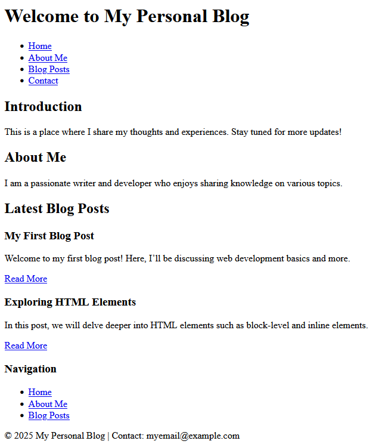

# My Personal Blog

## Description

My Personal Blog is a simple personal blogging website created using HTML. It provides a place to introduce myself, share my interests, display the latest blog posts, and provide contact information.

The webpage includes a navigation menu, an introduction section, an About Me section, blog post previews, a sidebar navigation area, and a footer.

## Features

- Displays a welcome heading
- Provides navigation links to different sections
- Includes an introduction section
- Displays personal information in the About Me section
- Shows previews of the latest blog posts
- Provides links to read full blog posts
- Includes sidebar navigation
- Displays contact information in the footer
- Uses HTML metadata for page description and responsive viewport settings
- Links an external CSS stylesheet

## Technologies Used

- HTML5
- CSS3
- Visual Studio Code

## HTML Concepts Used

- HTML document structure
- Headings and paragraphs
- Semantic HTML elements
- Header and footer
- Navigation using `<nav>`
- Main content using `<main>`
- Sections using `<section>`
- Blog articles using `<article>`
- Sidebar using `<aside>`
- Hyperlinks using `<a>`
- Unordered lists using `<ul>` and `<li>`
- Meta tags
- External CSS linking
- Internal page navigation using IDs
- HTML entities such as `&copy;`

## How to Run

1. Open Visual Studio Code.
2. Open the project folder.
3. Make sure the HTML file and `style.css` are in the correct locations.
4. Open the HTML file.
5. Run it using a web browser or the Live Server extension in VS Code.

## Project Structure

My_Personal_Blog/
│
├── index.html
├── style.css
├── blog-post1.html
├── blog-post2.html
└── README.md

Note: The blog post pages and CSS file should be created separately if they are not already available.

## Page Sections

1. **Home:** Introduces the purpose of the blog.
2. **About:** Provides information about the author and interests.
3. **Blog Posts:** Displays previews of the latest blog posts.
4. **Navigation:** Provides additional links to important sections.
5. **Footer:** Displays the copyright notice and contact email.

## Output

The webpage displays a personal blog with a header, navigation menu, introduction, About Me section, blog post previews, sidebar navigation, and footer.

To add a screenshot of the webpage, save it as `personal_blog.png` in the same folder as this README and use:

## Future Improvements

- Add CSS styling for a more attractive layout
- Make the website responsive for mobile devices
- Create complete pages for each blog post
- Add images to blog posts
- Add a search feature for blog posts
- Add a comment section
- Add social media links
- Store and manage blog posts dynamically

## Author

**P. Uma Naga Srinivas**

B.Tech - Artificial Intelligence & Machine Learning